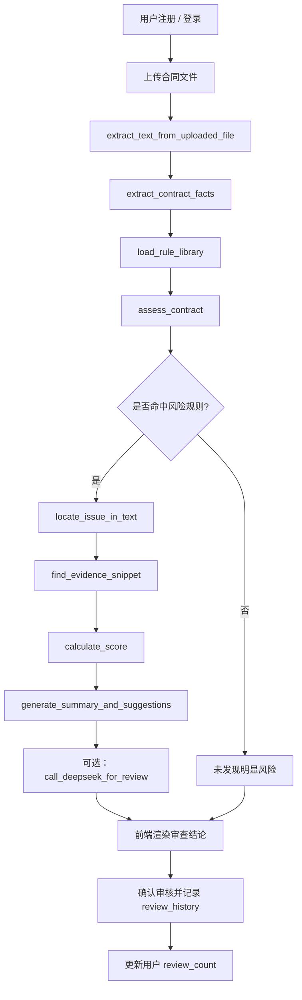

# 企业合同审核关键条款识别智能体需求优化说明

## 一、总体目标

构建一套适用于企业法务、采购、商务和管理层协同的合同审核智能体，核心目标是：

1. 减少人工审核耗时；
2. 提高关键条款检出率；
3. 控制误报与漏报；
4. 对高风险条款形成可执行建议；
5. 保留人工最终决策权并形成闭环反馈。

本方案将原有三阶段思路扩展为六层工程体系：

- 知识准备层
- 文档解析层
- 条款抽取层
- 规则引擎层
- 多智能体协同层
- 人机协同与持续迭代层

## 二、核心设计原则

1. LLM 专注语义理解与推理；
2. 硬性规则优先由代码执行；
3. 人工保留最终审批权；
4. 审核结果必须可追溯、可审计、可回流；
5. 规则与条款库应版本化管理；
6. 对同一账号设置 5 次免费审核上限。

## 三、知识准备层优化

知识基础不能只停留在“文档库”，必须形成结构化、可检索、可比对的知识资产。

### 1. 法律法规库
需要覆盖：
- 民法典合同编
- 公司法对外担保相关规定
- 企业内部控制应用指引
- 行业采购和工程类相关法规

### 2. 标准条款库
包括：
- 保密条款
- 付款条款
- 质保和责任限制
- 违约与索赔
- 争议解决
- 知识产权归属

### 3. 风险规则库
规则必须具备：
- 触发条件
- 风险等级
- 依据来源
- 建议动作

### 4. 供应商主数据库
用于核验：
- 企业工商信息
- 行政处罚
- 失信记录
- 重大诉讼
- 历史合作评价

### 5. 历史案例库
要求以“案件-条款-风险-处理结果”的形式存档，形成相似案例检索能力。

## 四、文档解析与切片层优化

- 支持 PDF、Word、TXT 文件上传；
- 自动识别标题、正文、表格、签章等版面区域；
- 表格要保留结构，跨页表格需保留关联；
- 正文按语义段落切片，避免简单分页误切；
- 长合同采用“首片段优先 + 上下文传递”的方法。

## 五、条款抽取层优化

### 1. 必须关心的关键字段
- 甲乙方主体信息
- 合同金额、币种、支付条件
- 付款比例、付款期限
- 生效日期、签署日期
- 质保期限
- 违约责任
- 保密义务
- 知识产权归属
- 不可抗力
- 争议解决方式

### 2. 结构化输出
统一采用六元组：

- 受监管实体
- 审计属性
- 归一化值
- 文档范围
- 源片段
- 置信度

## 六、规则引擎和评分模型优化

采用双通道：
- 可量化硬规则由代码执行；
- 语义判断部分由 LLM 辅助。

评分模型参考百分制：
- 80-100：低风险
- 60-79：中风险
- 40-59：较高风险
- 0-39：高风险

## 七、人机协同机制优化

- 刚性不通过：存在明显不合规或高风险条款；
- 柔性不通过：存在中风险或偏差条款，完成确认后继续流转；
- 柔性通过：仅提示并记录，不阻塞流程；
- 所有审核意见都保留人工采纳/排除/待补证回流机制。

## 八、Web 版功能要求

1. 用户注册与登录；
2. 合同上传与解析；
3. 自动抽取关键条款；
4. 风险识别与风险等级判定；
5. 修改建议输出；
6. 每账户 5 次免费审查；
7. 审核日志记录；
8. 可扩展接入更强的 LLM 和企业知识库。

## 九、验收指标建议

- 关键条款检出率 ≥95%
- 基础字段抽取准确率 ≥94%
- 高风险漏报率 ≤2%
- 平均审核时间 ≤5 分钟/份
- 误报率 ≤15%

## 十、项目落地建议

本项目已完成原型落地，可在企业试点推广前，先在 25-50 份真实或代表性合同上进行验证，并逐步增加：
- OCR 能力
- 跨页表格解析
- 模板条款库管理
- 审批流闭环
- 法务知识库更新机制

---

## 十一、审核流程总图（流程图 + 代码对应关系）

### 1. 审核主流程图

### 2. 代码逐层对应关系

| 流程节点 | 核心代码 | 作用 | 说明 |
| --- | --- | --- | --- |
| 账号与权限 | app.py 中的 register_user / login_user / get_user_review_count | 用户管理 | 提供注册、登录、免费次数上限控制 |
| 文件上传 | app.py 中的 render_app 和 st.file_uploader | 合同输入 | 接受 PDF / Word / TXT 文件 |
| 文本抽取 | extract_text_from_uploaded_file、extract_text_from_pdf、extract_text_from_docx | 转文本 | 将不同格式合同统一转成纯文本 |
| 关键事实抽取 | extract_contract_facts | 结构化字段识别 | 抽取金额、预付款、质保、付款期限等 |
| 风险规则加载 | load_rule_library | 规则库装载 | 读取 knowledge/rules/risk_rules.json |
| 规则判断 | assess_contract | 风险判定 | 按逻辑类型逐条筛查风险条款 |
| 原文定位 | locate_issue_in_text | 定位条款位置 | 找到对应段落，在界面中展示“条款位置” |
| 证据提取 | find_evidence_snippet | 证据截取 | 提取风险相关原文片段 |
| 评分 | calculate_score | 风险等级 | 0-100 评分并输出高/中/低风险 |
| 总结输出 | generate_summary_and_suggestions | 审核结论概述 | 生成简洁的汇总说明 |
| 增强意见 | call_deepseek_for_review | LLM 复核 | 在有 API Key 时，补充专业法务意见 |
| 数据落库 | save_review_history / update_review_count | 审核记录 | 保存审核结果和账号审核次数 |

### 3. 关键实现入口

- 入口函数：app.py 中的 main()
- 登录与注册界面：render_auth()
- 审核主界面：render_app()
- 审核结论展示：风险批注、审查结论、AI 合同审查增强意见

### 4. 关键文件对应关系

- app.py：主程序，负责审核逻辑、规则执行与前端展示
- knowledge/rules/risk_rules.json：规则库，定义什么条件算风险
- knowledge/standards/clause_library.json：模板条款库
- knowledge/legal/：法律与合规知识来源
- data/contract_review.db：SQLite 数据库，保存用户和审核记录

### 5. 审核链路说明

一个合同审核会经历以下精确步骤：

1. 用户登录后上传合同；
2. 系统读取文件内容并转成纯文本；
3. 抽取金额、付款、质保、争议解决等字段；
4. 将字段与规则库逐条匹配；
5. 命中风险后，定位原文段落和证据；
6. 计算风险分数和等级；
7. 输出“风险点 + 条款位置 + 证据 + 建议”；
8. 记录本次审核，更新账号使用次数；
9. 必要时调用大模型补充法务意见。

### 6. 这套方案的核心价值

- 规则驱动：减少 “看起来像风险” 的误判；
- 证据可追溯：可直接回看原文段落；
- 结论可执行：不是笼统评价，而是明确修改建议；
- 适合企业场景：足够稳健、可扩展、可审计。

这也是当前项目最关键的设计：把“AI 辅助审核”转化为“可解释、可追溯、可执行”的企业风险审查流程。

---

